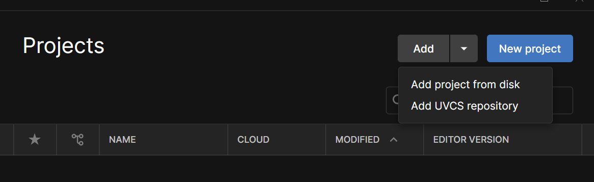
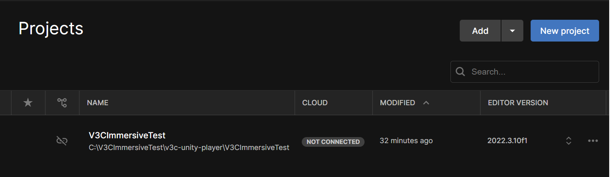

<p align="center">
  
</p>

<p align="center">
  A Unity package that decodes and plays V3C content, using the
  <a href="https://github.com/5G-MAG/rt-v3c-decoder-plugin">V3C Immersive Platform Decoder Plugin</a>.
</p>

<p align="center">
  
  <a href="https://github.com/5G-MAG/rt-v3c-unity-player/releases"></a>
  <a href="License.md"></a>
</p>

<p align="center">
  <a href="https://www.5g-mag.com/reference-tools/v3c/">Project page</a> &nbsp;&middot;&nbsp;
  <a href="https://github.com/5G-MAG/rt-v3c-unity-player/issues">Issues</a> &nbsp;&middot;&nbsp;
  <a href="https://www.5g-mag.com/contributing">Contributing</a>
</p>

---

## At a glance

|  |  |
|---|---|
| **Part of** | [MPEG V3C Immersive Platform](https://www.5g-mag.com/reference-tools/v3c/), alongside [rt-media-origin](https://github.com/5G-MAG/rt-media-origin), [rt-v3c-content](https://github.com/5G-MAG/rt-v3c-content), [rt-v3c-decoder-plugin](https://github.com/5G-MAG/rt-v3c-decoder-plugin), [rt-v3c-examples](https://github.com/5G-MAG/rt-v3c-examples) |

## Introduction

This repository holds a Unity package, `V3CDecoder`, and a small Unity project, `V3CImmersiveTest`,
that shows how to use it. The package plays V3C content with the libraries built in
[rt-v3c-decoder-plugin](https://github.com/5G-MAG/rt-v3c-decoder-plugin), which also provides the
V-PCC and MIV synthesizer plugins needed for rendering. Test content and configuration files come
from [rt-v3c-content](https://github.com/5G-MAG/rt-v3c-content). Windows and Android targets are
supported.

Questions on setting up or using the V3C Immersive Platform are answered in the
[FAQ](./docs/FAQ.md).

## Install dependencies

- Unity 6000.0.25f1, with Android build support if you will test on Android phones.
- Windows: a device with an NVIDIA GPU that supports hardware HEVC decoding (CUVID) and OpenGL Core
  4.5. NVIDIA lists the decoders each card has in its
  [Video encode and decode GPU support](https://developer.nvidia.com/video-encode-and-decode-gpu-support-matrix-new)
  matrix.
- Android: a device that supports OpenGL ES 3.2 and HEVC hardware decoding (MediaCodec).

## Downloading

```shell
git clone https://github.com/5G-MAG/rt-v3c-unity-player  
```

## Building

### Installing the decoder plugin

The package needs the libraries built in
[rt-v3c-decoder-plugin](https://github.com/5G-MAG/rt-v3c-decoder-plugin). Build them by following
the instructions in that repository, then copy them into the package with the script
`/Scripts/copy_libs.sh` from that repository. The commands below assume both repositories are cloned
side by side.

#### Windows

```shell
cd rt-v3c-unity-player
../rt-v3c-decoder-plugin/Scripts/copy_libs.sh ./Packages/V3CDecoder/Runtime/Plugins release Windows
```

With `release`, the script copies into `Packages/V3CDecoder/Runtime/Plugins` the DLLs from these
folders of rt-v3c-decoder-plugin: `Output/Windows/Release/x86_64`, `Libraries/iloj/release/msvc/bin`
and `Libraries/Windows/Release/x86_64`.

#### Android

```shell
cd rt-v3c-unity-player
../rt-v3c-decoder-plugin/Scripts/copy_libs.sh ./Packages/V3CDecoder/Runtime/Plugins release Android
```

With `release`, the script copies:

- the jar `V3CImmersiveDecoderVideo.jar`, from `Libraries/iloj/release/android` of
  rt-v3c-decoder-plugin, to `Packages/V3CDecoder/Runtime/Plugins/Android`;
- the `.so` files from `Output/Android/Release/arm64-v8a`, `Libraries/iloj/release/android/arm64-v8a/lib`
  and `Libraries/Android/Release/arm64-v8a` of rt-v3c-decoder-plugin, to
  `Packages/V3CDecoder/Runtime/Plugins/Android/libs/arm64-v8a`.

### Opening the project in Unity

In Unity Hub, choose Add, then Add project from disk.



Select the directory `rt-v3c-unity-player/V3CImmersiveTest` and click Add Project.



Then select V3CImmersiveTest to open it in Unity.

#### Player settings

The test project, and any project that uses the V3CDecoder package, needs these player settings
(Edit, Project Settings, Player) to run and build:

- Graphics APIs for Windows: OpenGLCore
- Graphics APIs for Android: OpenGLES3
- Android scripting backend: IL2CPP, with arm64-v8a as the target architecture

The package checks these settings when it is imported, and reports any that are wrong as errors in
the Unity Console.

### Building the demo scene

Check that the project is open on the scene V3C Simple Player. If it is not, load it from
Assets/Scenes, or from File, Open Scene, selecting `Scenes/V3C Simple Player.unity`.

#### Windows

Open File, Build Settings (Ctrl+Shift+B), select the Standalone Windows target, then Build or Build
and Run. Unity asks for a directory to hold the `.exe` and its files; use an empty one.

#### Android

Open File, Build Settings (Ctrl+Shift+B), select the Android target, then Build or Build and Run.

Unity generates an `.apk` file that you can copy to your phone and install. Build and Run needs USB
debugging enabled on the device, which requires developer mode.

The content and configuration files must be installed on the device by hand (see
[Configuration](#configuration)). Run the application once on the device first, so that it creates
its data folder.

## Running

Once the demo content is set up (see [Configuration](#configuration)), press Play in the Editor.


### Controls

The Play button, on the left of the screen, loads the first stream; pressing it again stops the
decoder. The Next arrow then steps through the streams in this order:

1. V-PCC Football player (test content, loaded by Play)
2. MIV MVD Dance
3. MIV MPI Mannequin
4. V-PCC Football player, streamed by your DASH server
5. MIV MVD Dance, streamed by your DASH server
6. MIV MPI Mannequin, streamed by your DASH server

The Previous arrow goes back to the previous content, and the circular arrow resets the camera.

| Content | Action | Windows | Android |
|---|---|---|---|
| V-PCC | Rotate the camera around the model | Left click and drag | One-finger swipe |
| V-PCC | Move towards the model | Scroll wheel | Two-finger pinch |
| MIV | Move in the x/y plane | Left click and drag | One-finger swipe |
| MIV | Rotate about the x/y axes | Right click and drag | Two-finger swipe |
| MIV | Zoom | Scroll wheel | Two-finger pinch |

## Configuration

Example configuration files and V3C test content are in
[rt-v3c-content](https://github.com/5G-MAG/rt-v3c-content), which is also available as the Git
submodule `rt-v3c-decoder-plugin/V3C-Content`. Its README describes the test content in the
`on-device-data` and `on-server-data` folders and the JSON configuration files, `config.json` and
`library.json`.

### Local data

Copy the contents of `rt-v3c-decoder-plugin/V3C-Content/on-device-data` (the `config.json` file and
the `data` folder) into the application's local data folder.

On Windows, this folder is needed both for testing in the Unity Editor and for the built
application:

`C:/Users/[your-user-name]/AppData/LocalLow/InterDigital/V3CSimplePlayer/`

On Android, depending on the phone, it is

`file/storage/emulated/0/Android/data/com.InterDigital.V3CSimplePlayer/files`

or `Android/data/com.InterDigital.V3CSimplePlayer/files`.

### Remote data

Copy the contents of `rt-v3c-decoder-plugin/V3C-Content/on-server-data` to a DASH server.
`README_dash_server.md` in the `V3C-Content` folder describes how to set one up. Then edit
`config.json` to point at your server:

```
  "Networking": {  
    "Servers": [  
      {  
        "Name": "myserver", <= replace with your server name
        "IP": "127.0.0.1",   <= replace with IP address of your server
        "Port": 8080,        <= replace with port number of your server
        "MaxConnections": 10  
      }  
    ],  
    "SegmentsBufferCapacity": 4  
  },  
```

and update `library.json` for the content on your server:

```
{
      "BaseDirectory": "S41C2RAR05_footprod_R24",
      "Mode": "dash",
      "Name": "S41C2RAR05_footprod_R24 Remote 1GOP",
      "StreamList": [
        {
          "Duration": [

          ],
          "NbFrame": [

          ],
          "NbSegment": 4,
          "Path": "S41C2RAR05_footprod_%04d.bin",
          "ServerName": "myserver",                                <= put your server name
          "Type": "vpcc",
          "Url": "XXX/S41C2RAR05_footprod_1GOP/stream.mpd" <=  replace XXX with the path of the content on your DASH Server
          }
      ]
    },
```

## Contributing

Contributions are welcome. How to raise an issue, fork the repository and open a pull request, and
the Contributor License Agreement required before code can be merged, are described at
<https://www.5g-mag.com/contributing>.

## License

Distributed under the 5G-MAG Public License v1.0. See [License.md](License.md); the licence terms
are also available [online](https://drive.google.com/file/d/1cinCiA778IErENZ3JN52VFW-1ffHpx7Z/view).

This project uses software from
[rt-v3c-decoder-plugin](https://github.com/5G-MAG/rt-v3c-decoder-plugin); check the licences in that
project before using it.
